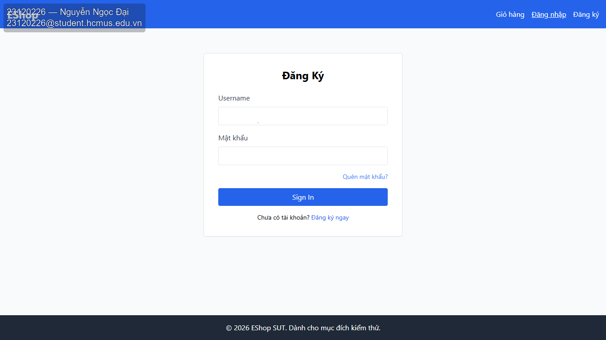
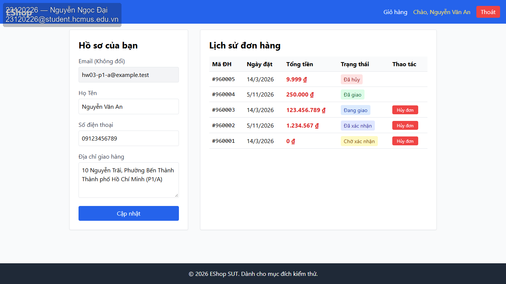
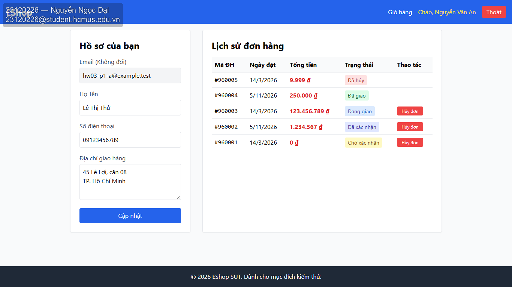
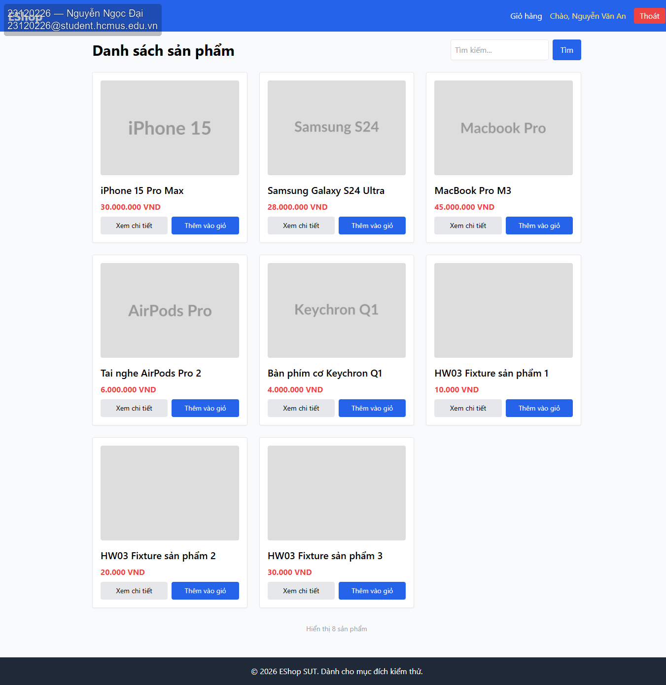
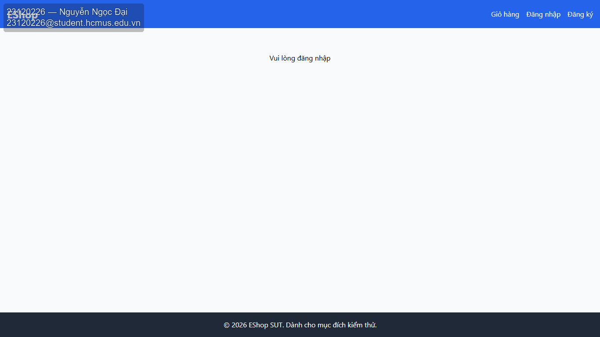
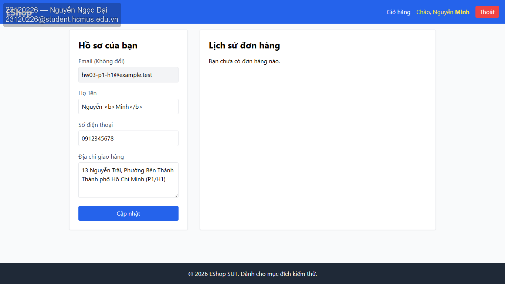

# Bug Report

Đã đối chiếu [GitHub Issues](https://github.com/nndai/HW03_AI_GUIUsability/issues): 22 issue, gồm 19 báo cáo gắn Bug và 3 issue theo dõi Blocked (GUI-033/034/035). Các mục chung nguyên nhân validation không được suy thành lỗi gốc độc lập. U-D01 liên quan #7; U-D02 liên quan #11.

| Checklist | Issue | Trạng thái |
| --- | --- | --- |
| GUI-004 | [#1](https://github.com/nndai/HW03_AI_GUIUsability/issues/1) | Bug |
| GUI-005 | [#2](https://github.com/nndai/HW03_AI_GUIUsability/issues/2) | Bug |
| GUI-013 | [#3](https://github.com/nndai/HW03_AI_GUIUsability/issues/3) | Bug |
| GUI-014 | [#4](https://github.com/nndai/HW03_AI_GUIUsability/issues/4) | Bug |
| GUI-015 | [#5](https://github.com/nndai/HW03_AI_GUIUsability/issues/5) | Bug |
| GUI-016 | [#6](https://github.com/nndai/HW03_AI_GUIUsability/issues/6) | Bug |
| GUI-017 | [#7](https://github.com/nndai/HW03_AI_GUIUsability/issues/7) | Bug |
| GUI-018 | [#8](https://github.com/nndai/HW03_AI_GUIUsability/issues/8) | Bug |
| GUI-019 | [#9](https://github.com/nndai/HW03_AI_GUIUsability/issues/9) | Bug |
| GUI-020 | [#10](https://github.com/nndai/HW03_AI_GUIUsability/issues/10) | Bug |
| GUI-021 | [#11](https://github.com/nndai/HW03_AI_GUIUsability/issues/11) | Bug |
| GUI-023 | [#12](https://github.com/nndai/HW03_AI_GUIUsability/issues/12) | Bug |
| GUI-025 | [#13](https://github.com/nndai/HW03_AI_GUIUsability/issues/13) | Bug |
| GUI-026 | [#14](https://github.com/nndai/HW03_AI_GUIUsability/issues/14) | Bug |
| GUI-032 | [#15](https://github.com/nndai/HW03_AI_GUIUsability/issues/15) | Bug |
| GUI-033 | [#16](https://github.com/nndai/HW03_AI_GUIUsability/issues/16) | Blocked |
| GUI-034 | [#17](https://github.com/nndai/HW03_AI_GUIUsability/issues/17) | Blocked |
| GUI-035 | [#18](https://github.com/nndai/HW03_AI_GUIUsability/issues/18) | Blocked |
| GUI-037 | [#19](https://github.com/nndai/HW03_AI_GUIUsability/issues/19) | Bug |
| GUI-038 | [#20](https://github.com/nndai/HW03_AI_GUIUsability/issues/20) | Bug |
| GUI-039 | [#21](https://github.com/nndai/HW03_AI_GUIUsability/issues/21) | Bug |
| GUI-042 | [#22](https://github.com/nndai/HW03_AI_GUIUsability/issues/22) | Bug |

Nội dung bug report đã đăng trên GitHub:

#### [#1 — [GUI-004][Bug] Trang đăng nhập còn nhãn tiếng Anh](https://github.com/nndai/HW03_AI_GUIUsability/issues/1)

**Môi trường:** Chrome 156.0.8078.80 / Windows 10.0.26300; 09/11/2026.

**Bước tái hiện:** Đọc nhãn, tiêu đề, nút, message và trạng thái do SUT hiển thị trong các bước checklist.

**Thực tế:** Trong đường đăng nhập dùng cho checklist, SUT hiển thị nút “Sign In” và nhãn “Username”, chưa nhất quán tiếng Việt. Profile dùng nhãn Việt.

**Mong đợi:** Nội dung SUT dùng tiếng Việt có dấu nhất quán, trừ thuật ngữ kỹ thuật chuẩn và dữ liệu tài khoản do người dùng đặt; không chấm ngôn ngữ UI của browser.

**Ảnh:**

#### [#2 — [GUI-005][Bug] Trang Profile thiếu tiêu đề h1](https://github.com/nndai/HW03_AI_GUIUsability/issues/2)

**Môi trường:** Chrome 156.0.8078.80 / Windows 10.0.26300; 09/11/2026.

**Bước tái hiện:** Mở /profile; đối chiếu heading thấy trên trang với DOM chỉ đọc.

**Thực tế:** Profile có 0 h1; hai tiêu đề phần đều là h2.

**Mong đợi:** Có đúng 1 h1 mô tả trang; hai phần hồ sơ/lịch sử có heading phân biệt; không lấy tên tab browser thay cho h1.

**Ảnh:**

#### [#3 — [GUI-013][Bug] Trường email dùng type=text](https://github.com/nndai/HW03_AI_GUIUsability/issues/3)

**Môi trường:** Chrome 156.0.8078.80 / Windows 10.0.26300; 09/11/2026.

**Bước tái hiện:** Thử click/gõ/paste vào email; xem thuộc tính type qua DOM chỉ đọc.

**Thực tế:** Email disabled và không sửa được qua bàn phím, nhưng type thực tế là text, không phải email.

**Mong đợi:** Email vẫn đúng tài khoản và không đổi qua GUI; field email có type=email theo FR-22 dù đang disabled/readonly. Không thử validate email nhập mới.

**Ảnh:**

#### [#4 — [GUI-014][Bug] Các trường hồ sơ thiếu accessible name](https://github.com/nndai/HW03_AI_GUIUsability/issues/4)

**Môi trường:** Chrome 156.0.8078.80 / Windows 10.0.26300; 09/11/2026.

**Bước tái hiện:** Xem nhãn Tên/Điện thoại/Địa chỉ và accessible name của từng control.

**Thực tế:** Họ Tên, Số điện thoại và Địa chỉ có nhãn nhìn thấy nhưng không có accessible name qua label/aria; placeholder phone/address không thay nhãn.

**Mong đợi:** Nhãn diễn đạt đúng trường; control có tên truy cập đúng vai trò qua label/aria-label/aria-labelledby; placeholder không thay nhãn.

**Ảnh:**

#### [#5 — [GUI-015][Bug] Trường Họ Tên bắt buộc thiếu dấu *](https://github.com/nndai/HW03_AI_GUIUsability/issues/5)

**Môi trường:** Chrome 156.0.8078.80 / Windows 10.0.26300; 09/11/2026.

**Bước tái hiện:** Ghi các trường đang được form khai báo required hoặc tài liệu đã chốt là bắt buộc; so sánh nhãn.

**Thực tế:** Field Họ Tên có required nhưng nhãn không có dấu *.

**Mong đợi:** Mỗi trường được xác định bắt buộc đều có * cạnh nhãn. Mục này không tự kết luận phone/address bắt buộc hay tên toàn khoảng trắng hợp lệ.

**Ảnh:**

#### [#6 — [GUI-016][Bug] Không cập nhật được tên tiếng Việt với điện thoại hợp lệ](https://github.com/nndai/HW03_AI_GUIUsability/issues/6)

**Môi trường:** Chrome 156.0.8078.80 / Windows 10.0.26300; 09/11/2026.

**Bước tái hiện:** Giữ phone hợp lệ; đổi tên A thành Nguyễn Văn Mẫu, lưu và mở lại.

**Thực tế:** Dữ liệu hợp lệ (tên Nguyễn Văn Mẫu, phone 0912345678) bị validation phone từ chối trước PUT, nên không hoàn thành cập nhật tên theo FR-04. Chưa đánh giá được các bước sau lưu.

**Mong đợi:** Tên được cập nhật đúng dấu/ký tự và đúng tài khoản; không thay email/role. Không suy ra giới hạn tên dài từ dữ liệu mẫu.

**Phụ thuộc:** #7 — validation điện thoại hợp lệ.

**Ảnh:**

#### [#7 — [GUI-017][Bug] Validation từ chối điện thoại hợp lệ 10–11 chữ số đầu 0](https://github.com/nndai/HW03_AI_GUIUsability/issues/7)

**Môi trường:** Chrome 156.0.8078.80 / Windows 10.0.26300; 09/11/2026.

**Bước tái hiện:** Lần lượt gửi P: 091234567 (9), 0912345678 (10), 09123456789 (11), 091234567890 (12); trường khác hợp lệ.

**Thực tế:** 9 số: từ chối, đúng; 10 số: từ chối, sai; 11 số: từ chối, sai; 12 số: từ chối, đúng. Hai số hợp lệ đầu 0 không được lưu.

**Mong đợi:** 10/11 chữ số đầu 0 được chấp nhận và giữ số 0 đầu; 9/12 chữ số bị từ chối, không thay dữ liệu đã lưu bằng giá trị sai. Ghi actual từng biến thể.

**Ảnh:**

#### [#8 — [GUI-018][Bug] Lưu được điện thoại không bắt đầu bằng 0](https://github.com/nndai/HW03_AI_GUIUsability/issues/8)

**Môi trường:** Chrome 156.0.8078.80 / Windows 10.0.26300; 09/11/2026.

**Bước tái hiện:** Gửi 1912345678, 09a2345678, 09123-5678, +84912345678; giữ trường khác hợp lệ.

**Thực tế:** 1912345678 được PUT và lưu, sai expected. 09a2345678, 09123-5678, +84912345678 bị từ chối và không lưu.

**Mong đợi:** Không lưu các chuỗi có đầu số khác 0 hoặc chứa ký tự không phải chữ số. Các quyết định trim khoảng trắng được tách khỏi mục này.

**Ảnh:**

#### [#9 — [GUI-019][Bug] Không cập nhật được địa chỉ với điện thoại hợp lệ](https://github.com/nndai/HW03_AI_GUIUsability/issues/9)

**Môi trường:** Chrome 156.0.8078.80 / Windows 10.0.26300; 09/11/2026.

**Bước tái hiện:** Giữ tên/phone hợp lệ; nhập địa chỉ V có tiếng Việt, 2 dòng và dấu phẩy; lưu rồi mở lại.

**Thực tế:** Địa chỉ thử hợp lệ cùng phone 0912345678 bị validation phone từ chối trước PUT, nên không hoàn thành cập nhật địa chỉ. Chưa đánh giá được nội dung địa chỉ sau lưu/mở lại.

**Mong đợi:** Địa chỉ mặc định sau tải lại còn đủ từ, chữ số và dấu; không bị chuyển sang trường khác. Không tự quy định maxLength.

**Phụ thuộc:** #7 — validation điện thoại hợp lệ.

**Ảnh:**

#### [#10 — [GUI-020][Bug] Không lưu được hồ sơ bằng nút Cập nhật](https://github.com/nndai/HW03_AI_GUIUsability/issues/10)

**Môi trường:** Chrome 156.0.8078.80 / Windows 10.0.26300; 09/11/2026.

**Bước tái hiện:** Từ baseline A, đổi tên/phone/address hợp lệ; click Cập nhật một lần; đối chiếu bản lưu và request chỉ đọc.

**Thực tế:** Đã nhập ba trường hợp lệ và click Cập nhật; phone 09123456789 bị validation từ chối trước PUT, nên không hoàn thành cập nhật hồ sơ bằng chuột. Chưa đánh giá các kiểm tra sau lưu.

**Mong đợi:** Ba trường cập nhật đúng A; email/role không thay đổi và hồ sơ B giữ nguyên. Không gửi payload sửa role hoặc kiểm sâu API trong checklist GUI.

**Phụ thuộc:** #7 — validation điện thoại hợp lệ.

**Ảnh:**

#### [#11 — [GUI-021][Bug] Thông báo lỗi điện thoại sai quy tắc và thiếu lỗi trong form](https://github.com/nndai/HW03_AI_GUIUsability/issues/11)

**Môi trường:** Chrome 156.0.8078.80 / Windows 10.0.26300; 09/11/2026.

**Bước tái hiện:** Gửi 091234567 (9 số) rồi quan sát message và vùng trên Cập nhật.

**Thực tế:** Chỉ hiện alert “Số điện thoại không hợp lệ. Vui lòng nhập đúng 9-10 chữ số.”; không có lỗi inline phía trên submit và hướng dẫn sai quy tắc 0/10–11.

**Mong đợi:** Có lỗi nhận diện trường điện thoại và hướng dẫn quy tắc đầu 0, 10–11 số; lỗi hiển thị trong form phía trên submit theo FR-22; không chỉ kết luận từ alert ngoài form.

**Ảnh:**

#### [#12 — [GUI-023][Bug] Navbar không đánh dấu trang đang chọn](https://github.com/nndai/HW03_AI_GUIUsability/issues/12)

**Môi trường:** Chrome 156.0.8078.80 / Windows 10.0.26300; 09/11/2026.

**Bước tái hiện:** Từ Home vào /profile rồi trở lại Home; so sánh dấu chọn của link tài khoản.

**Thực tế:** Sau loại ảnh hưởng hover, link tài khoản có cùng class/màu/aria ở Home và Profile; không có dấu active theo route.

**Mong đợi:** Navbar có dấu highlight phân biệt trang hiện tại; không coi màu cố định giống nhau trên mọi route là bằng chứng active.

**Ảnh:**

#### [#13 — [GUI-025][Bug] Navbar thiếu badge khi giỏ có 3 sản phẩm](https://github.com/nndai/HW03_AI_GUIUsability/issues/13)

**Môi trường:** Chrome 156.0.8078.80 / Windows 10.0.26300; 09/11/2026.

**Bước tái hiện:** Chuẩn bị giỏ 0 rồi 3 sản phẩm khác nhau, mỗi loại số lượng 1; xem navbar tại Profile và mở Giỏ hàng.

**Thực tế:** Giỏ 0 đúng; thêm 3 sản phẩm khác nhau ×1 qua GUI, cart đúng 3 dòng ×1 nhưng navbar Profile không có badge 3.

**Mong đợi:** Link đi đúng /cart; badge phản ánh 3 khi có 3 sản phẩm; với 0 cho phép ẩn hoặc hiển thị 0. Không đánh giá flow checkout.

**Ảnh:**

#### [#14 — [GUI-026][Bug] Nút đăng xuất dùng nhãn “Thoát”](https://github.com/nndai/HW03_AI_GUIUsability/issues/14)

**Môi trường:** Chrome 156.0.8078.80 / Windows 10.0.26300; 09/11/2026.

**Bước tái hiện:** Tại Profile đã login A, xem nhãn nút và kích hoạt đăng xuất.

**Thực tế:** Nhãn thực tế “Thoát”, không phải “Đăng xuất”; sau click navbar về trạng thái chưa login.

**Mong đợi:** Nút mang nhãn Đăng xuất; sau click navbar trở về các lựa chọn chưa login. Bảo vệ dữ liệu kiểm tiếp tại GUI-031.

**Ảnh:**

#### [#15 — [GUI-032][Bug] Hiện yêu cầu đăng nhập khi đang khôi phục phiên](https://github.com/nndai/HW03_AI_GUIUsability/issues/15)

**Môi trường:** Chrome 156.0.8078.80 / Windows 10.0.26300; 09/11/2026.

**Bước tái hiện:** Reload khi token hợp lệ; làm chậm GET /users/me 3 giây trong môi trường thử.

**Thực tế:** Trong GET /users/me chậm 3 giây, trang khẳng định “Vui lòng đăng nhập”, không có trạng thái chờ trung tính; sau response thật trở về A.

**Mong đợi:** Trong lúc chưa biết kết quả có dấu chờ trung tính, không khẳng định đã mất phiên; khi API thành công hiện đúng A. 3 giây là điều kiện gây chậm, không phải SLA.

**Ảnh:**

#### [#16 — [GUI-033][Blocked] Chưa kiểm được phản hồi lưu thành công do validation điện thoại](https://github.com/nndai/HW03_AI_GUIUsability/issues/16)

**Môi trường:** Chrome 156.0.8078.80 / Windows 10.0.26300; 09/11/2026.

**Trạng thái:** Blocked — chưa có kết luận lỗi cho nhánh này.

**Bước tái hiện:** Gửi dữ liệu hợp lệ và chờ phản hồi API thành công.

**Thực tế:** Validation phone hợp lệ chặn trước PUT; chưa có response lưu thành công nên chưa tới nhánh kiểm feedback thành công và thứ tự response/thông báo.

**Mong đợi:** Chỉ sau khi request thành công mới có thông báo xác nhận đã cập nhật; không báo lỗi cho lần lưu đó. Cơ chế alert/toast/inline đều được ở nhánh success.

**Phụ thuộc:** #7 — validation điện thoại hợp lệ.

**Ảnh lỗi gây chặn:**

#### [#17 — [GUI-034][Blocked] Chưa kiểm được đồng bộ và giữ dữ liệu sau lưu](https://github.com/nndai/HW03_AI_GUIUsability/issues/17)

**Môi trường:** Chrome 156.0.8078.80 / Windows 10.0.26300; 09/11/2026.

**Trạng thái:** Blocked — chưa có kết luận lỗi cho nhánh này.

**Bước tái hiện:** Lưu tên/phone/address mới; xem form/navbar, rời Profile rồi mở lại và reload.

**Thực tế:** Validation phone hợp lệ chặn trước PUT; chưa có lần lưu thành công nên chưa tới nhánh kiểm đồng bộ navbar/form và persistence sau lưu/mở lại/reload.

**Mong đợi:** Tên trên navbar và dữ liệu form khớp bản đã lưu; các giá trị vẫn đúng sau mở lại/reload. Không dùng dữ liệu chỉ còn trong React state làm bằng chứng lưu.

**Phụ thuộc:** #7 — validation điện thoại hợp lệ.

**Ảnh lỗi gây chặn:**

#### [#18 — [GUI-035][Blocked] Chưa kiểm được lỗi lưu và phục hồi do validation điện thoại](https://github.com/nndai/HW03_AI_GUIUsability/issues/18)

**Môi trường:** Chrome 156.0.8078.80 / Windows 10.0.26300; 09/11/2026.

**Trạng thái:** Blocked — chưa có kết luận lỗi cho nhánh này.

**Bước tái hiện:** Gây PUT trả 500 hoặc mất mạng trong môi trường thử, gửi dữ liệu hợp lệ.

**Thực tế:** Đã cấu hình PUT 500 và network-abort nhưng validation phone chặn trước request; chưa kích hoạt nhánh lỗi lưu/mất mạng hoặc recovery. Không kết luận các nhánh này Failed.

**Mong đợi:** Không có thông báo thành công; có lỗi cho biết chưa lưu hoặc chưa xác nhận được kết quả và hướng thử lại; có thể gửi lại sau phục hồi mạng.

**Phụ thuộc:** #7 — validation điện thoại hợp lệ.

**Ảnh lỗi gây chặn:**

#### [#19 — [GUI-037][Bug] Hiện chưa có đơn hàng khi danh sách vẫn đang tải](https://github.com/nndai/HW03_AI_GUIUsability/issues/19)

**Môi trường:** Chrome 156.0.8078.80 / Windows 10.0.26300; 09/11/2026.

**Bước tái hiện:** Làm chậm GET my-orders 3 giây, mở Profile với tài khoản có đơn.

**Thực tế:** Trong GET đơn chậm 3 giây đã hiện “Bạn chưa có đơn hàng nào.”, không loading; sau response thật hiện đủ 5 đơn.

**Mong đợi:** Trong lúc chờ có loading/dấu đang lấy dữ liệu; chưa hiển thị khẳng định không có đơn; sau thành công chuyển sang bảng dữ liệu.

**Ảnh:**

#### [#20 — [GUI-038][Bug] Trạng thái chưa có đơn hàng thiếu hình minh họa](https://github.com/nndai/HW03_AI_GUIUsability/issues/20)

**Môi trường:** Chrome 156.0.8078.80 / Windows 10.0.26300; 09/11/2026.

**Bước tái hiện:** Dùng A0 không có đơn; chờ GET my-orders thành công trả [].

**Thực tế:** A0 thực sự không có đơn, GET 200 và message empty đúng; thiếu icon/hình minh họa.

**Mong đợi:** Có message thân thiện cho biết chưa có đơn và icon/hình minh họa; không hiển thị hàng đơn giả hoặc thông báo lỗi tải.

**Ảnh:**

#### [#21 — [GUI-039][Bug] Lỗi tải lịch sử đơn bị hiển thị thành chưa có đơn](https://github.com/nndai/HW03_AI_GUIUsability/issues/21)

**Môi trường:** Chrome 156.0.8078.80 / Windows 10.0.26300; 09/11/2026.

**Bước tái hiện:** Làm GET my-orders trả 500, rồi phục hồi API và reload/thử lại.

**Thực tế:** GET đơn 500 có kiểm soát lại hiện message empty, không có lỗi tải riêng; gỡ fault/reload lấy lại đúng 5 đơn thật.

**Mong đợi:** Khi lỗi có thông báo không tải được đơn, không đồng nhất với chưa có đơn; sau phục hồi có thể lấy và hiển thị dữ liệu thật. Không bắt buộc phải có nút Retry riêng.

**Ảnh:**

#### [#22 — [GUI-042][Bug] Navbar diễn giải HTML trong họ tên thay vì hiển thị văn bản](https://github.com/nndai/HW03_AI_GUIUsability/issues/22)

**Môi trường:** Chrome 156.0.8078.80 / Windows 10.0.26300; 09/11/2026.

**Bước tái hiện:** Dùng lần lượt tài khoản fixture H1/H2 có tên HTML chuẩn bị sẵn: `Nguyễn <b>Minh</b>` và `<em>An & Bình</em>`. Đăng nhập, mở Profile rồi reload; đối chiếu giá trị ô Họ tên, lời chào navbar và DOM. Chỉ kiểm hiển thị từ fixture, không nhập hoặc lưu tên.

**Thực tế:** Fixture H1/H2 có tên HTML chuẩn bị sẵn. Sau reload, form giữ nguyên chuỗi chứa thẻ; navbar tạo b cho H1 và em cho H2, hiện chữ đậm/nghiêng thay vì nguyên văn. Không có PUT nhập/lưu tên.

**Mong đợi:** Sau reload, ô Họ tên và lời chào navbar hiển thị nguyên văn tên fixture như văn bản, escape an toàn; không tạo phần tử HTML hoặc định dạng đậm/nghiêng từ tên. Không đánh giá bước nhập/lưu.

**Ảnh:**

